# Portal do Assistido — DPE-GO

Sistema em que o cidadão pede atendimento à Defensoria Pública do Estado de Goiás e acompanha o pedido, e em que a equipe faz a triagem num quadro kanban, com devolutiva no portal e por e-mail.

[](https://github.com/yandramorais/portal-assistido-dpe/actions/workflows/ci.yml)

> Projeto de demonstração desenvolvido para processo seletivo. Não é um sistema oficial da Defensoria Pública do Estado de Goiás; todos os dados são fictícios.

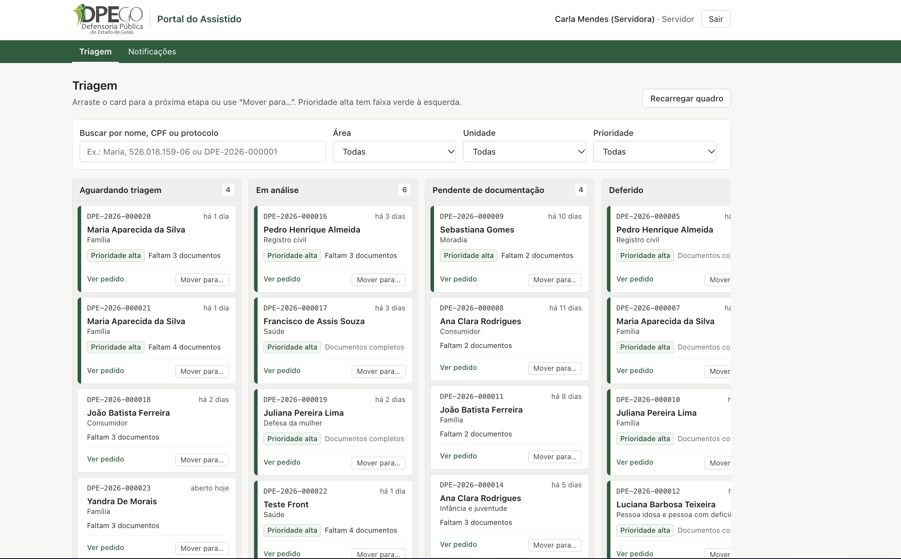

## Sumário

- [Telas](#telas)
- [Como rodar](#como-rodar)
- [Como recarregar os dados](#como-recarregar-os-dados)
- [Arquitetura](#arquitetura)
- [Regras de negócio](#regras-de-negócio)
- [Decisões técnicas](#decisões-técnicas)
- [Próximos passos](#próximos-passos)
- [Como rodar os testes](#como-rodar-os-testes)
- [Suporte N2](docs/SUPORTE-N2.md)
- [Autora](#autora)

## Telas

### Assistido

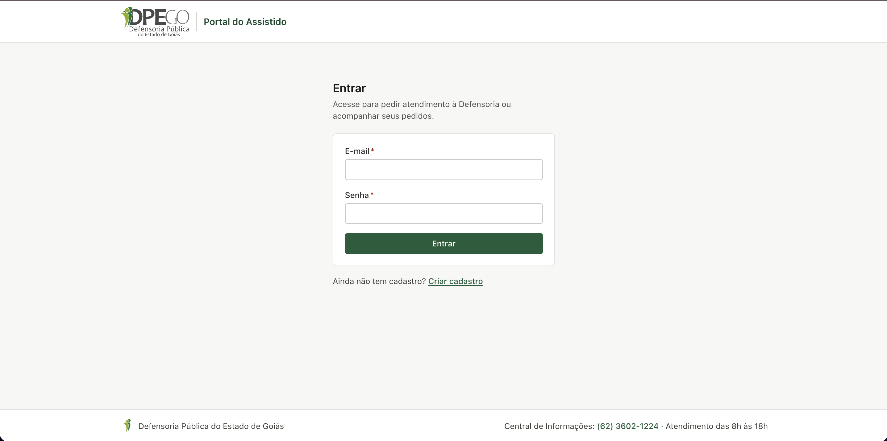
Entrada com e-mail e senha; quem não tem conta segue para o cadastro.

<table>
  <tr>
    <td>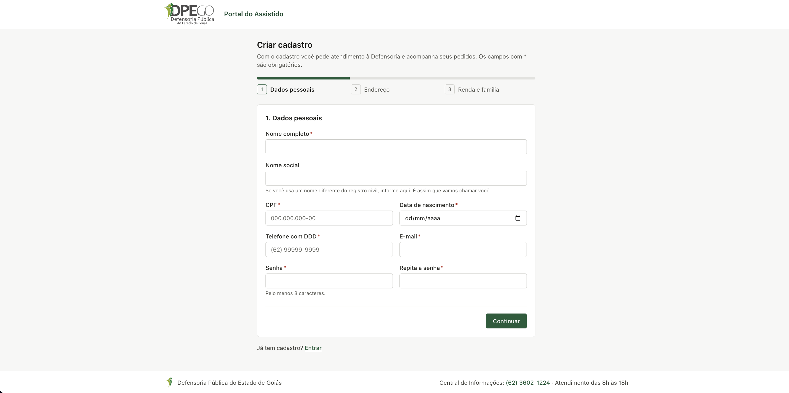</td>
    <td>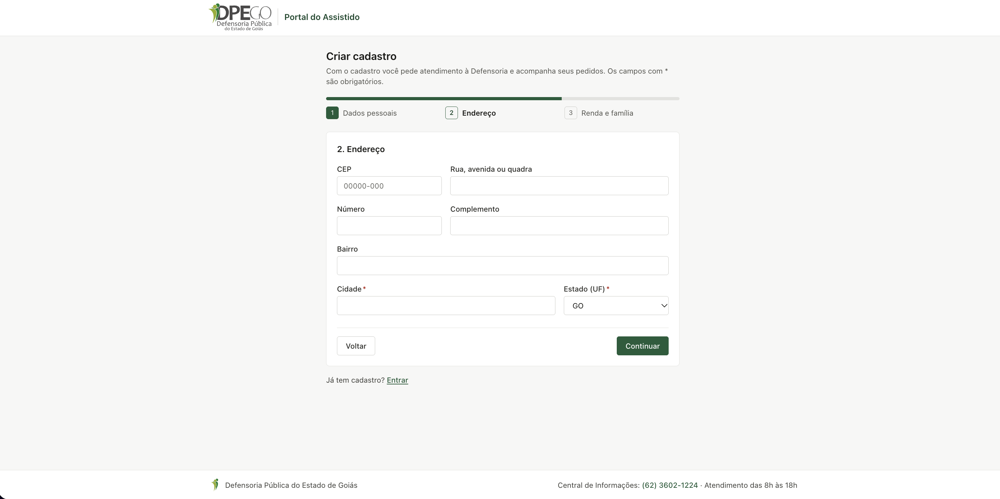</td>
    <td>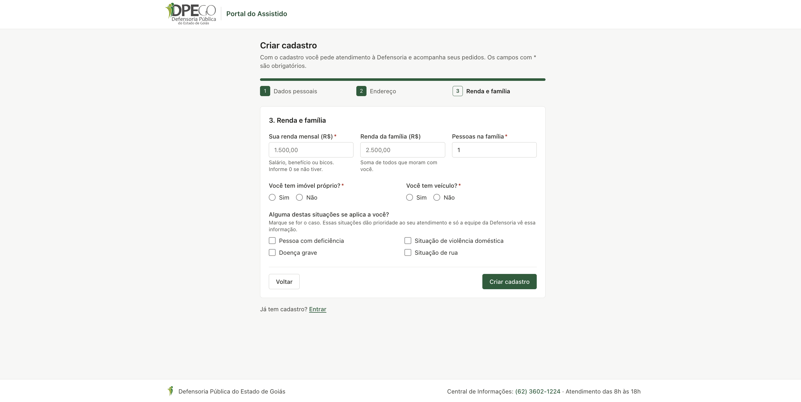</td>
  </tr>
  <tr>
    <td>Passo 1: dados pessoais, com validação de CPF.</td>
    <td>Passo 2: contato, endereço e acesso.</td>
    <td>Passo 3: renda, família e situações de vulnerabilidade.</td>
  </tr>
</table>

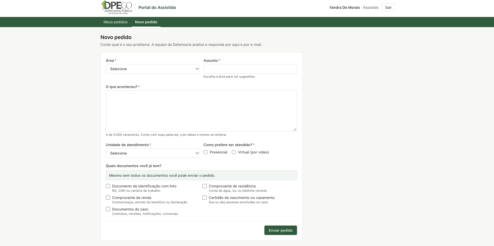
Novo pedido: área, unidade, assunto, relato, modalidade e checklist de documentos.

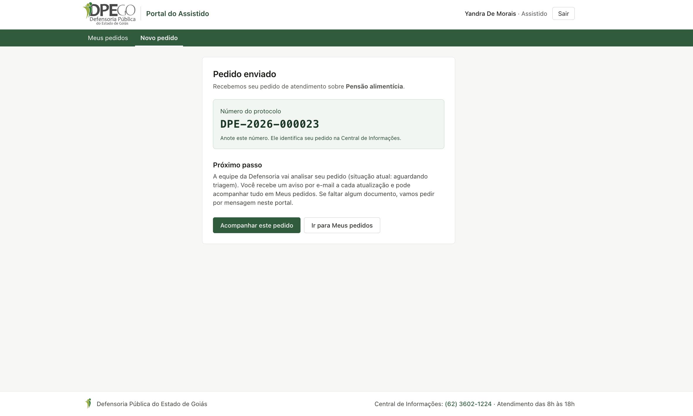
Confirmação com o número de protocolo e os próximos passos.

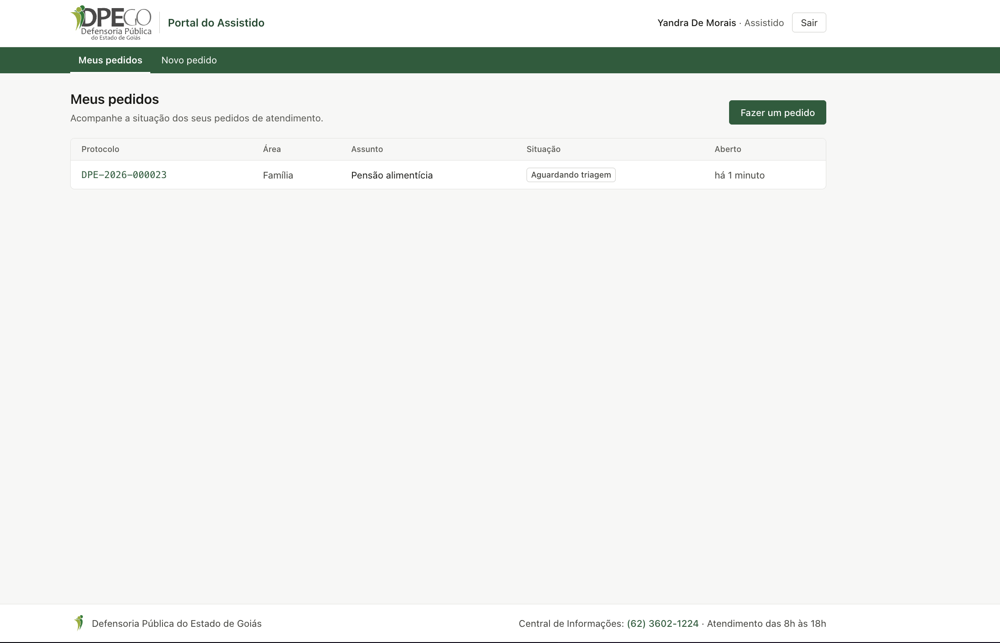
Lista dos pedidos do assistido com a situação atual de cada um.

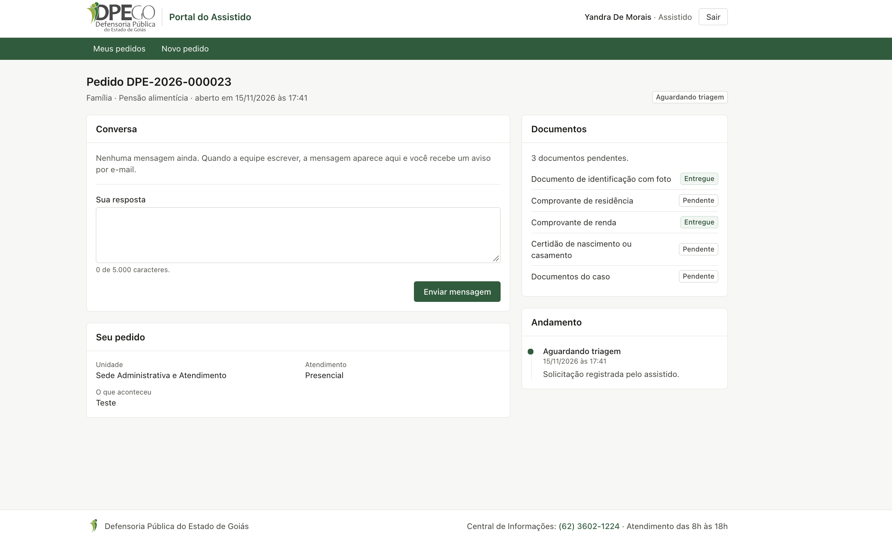
Detalhe do pedido: linha do tempo, decisão da equipe e conversa.

### Equipe da Defensoria


Quadro de triagem com filtros por área, unidade e prioridade; prioridade alta tem faixa verde à esquerda.

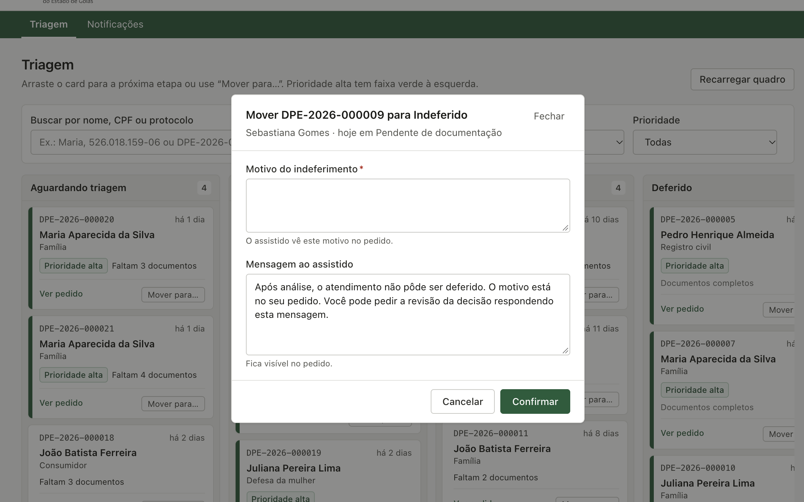
Transição de status com os campos exigidos pelo destino, como motivo e devolutiva ao assistido.

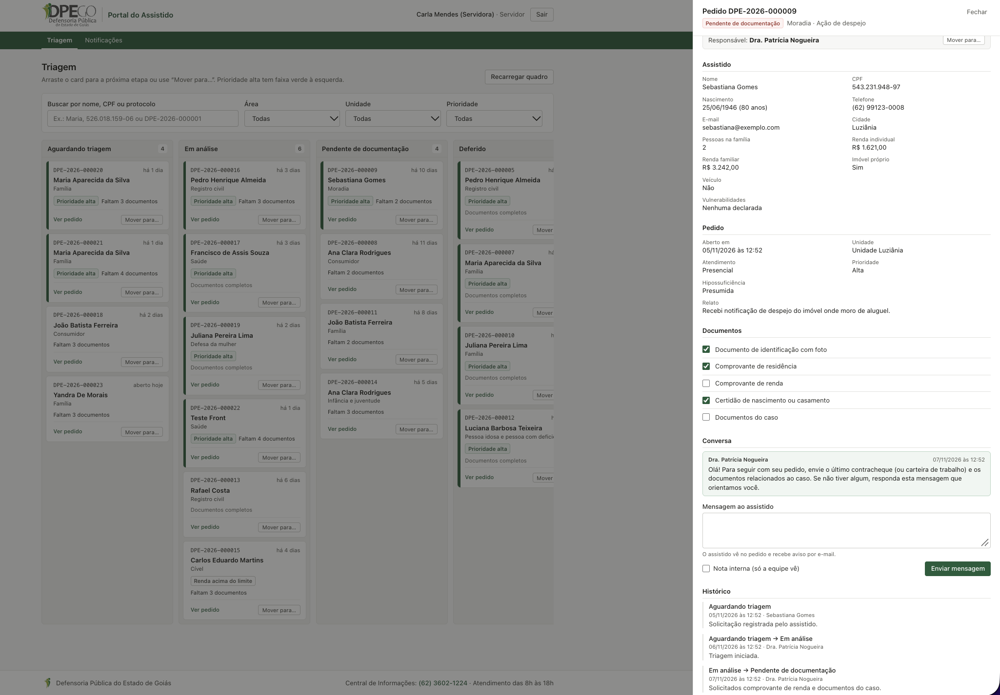
Painel lateral com dados do pedido, histórico de status e nota interna da equipe.

## Como rodar

Só é preciso ter Docker com Docker Compose.

```bash
git clone https://github.com/yandramorais/portal-assistido-dpe.git
cd portal-assistido-dpe
cp .env.example .env
docker compose up --build
```

O back-end sobe com o perfil `dev`, que aplica o schema e carrega os dados fictícios de `docs/seed.sql`.

| Serviço | Endereço |
| --- | --- |
| Portal | http://localhost:5173 |
| API | http://localhost:8080 |
| Swagger | http://localhost:8080/swagger-ui.html |
| Mailpit (e-mails enviados) | http://localhost:8025 |

Todos os usuários de teste usam a senha `Senha@123`.

| Usuário | Perfil | O que mostra |
| --- | --- | --- |
| servidor@dpe.local | Servidor | Quadro de triagem completo, transições, notas internas e log de e-mails, incluindo um envio com falha. |
| defensor@dpe.local | Defensor | As mesmas telas da equipe; é o responsável por parte dos pedidos do seed. |
| maria@exemplo.com | Assistida | Pessoa idosa (prioridade alta) com um pedido aguardando triagem e outro deferido com data e local de atendimento. |
| carlos@exemplo.com | Assistido | Renda acima do critério: pedido indeferido com motivo e outro aguardando triagem. |
| rafael@exemplo.com | Assistido | Uso do nome social em todo o portal e um pedido em análise. |

## Como recarregar os dados

O seed limpa as tabelas e popula tudo de novo, em uma única transação. Usuário e banco são os de `DB_USER` e `DB_NAME` no `.env` (`portal` e `portal` no `.env.example`):

```bash
docker compose exec -T postgres psql -U portal -d portal -1 -v ON_ERROR_STOP=1 -f - < docs/seed.sql
```

## Arquitetura

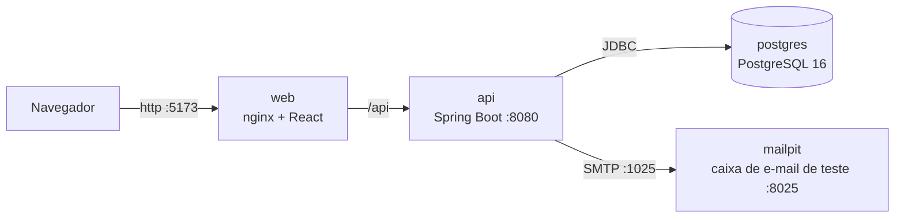

- `frontend/`: React 18, TypeScript, Vite, Tailwind CSS, TanStack Query, React Hook Form com Zod e dnd-kit. Em produção é servido pelo nginx, que repassa `/api` ao back-end.
- `backend/`: Java 21 e Spring Boot 3, com JPA, Spring Security (JWT), Liquibase, springdoc-openapi, Actuator e envio de e-mail. Organizado por domínio em `auth`, `assistido`, `solicitacao`, `workflow`, `notificacao`, `unidade` e `shared`.

Fluxo de status do pedido:

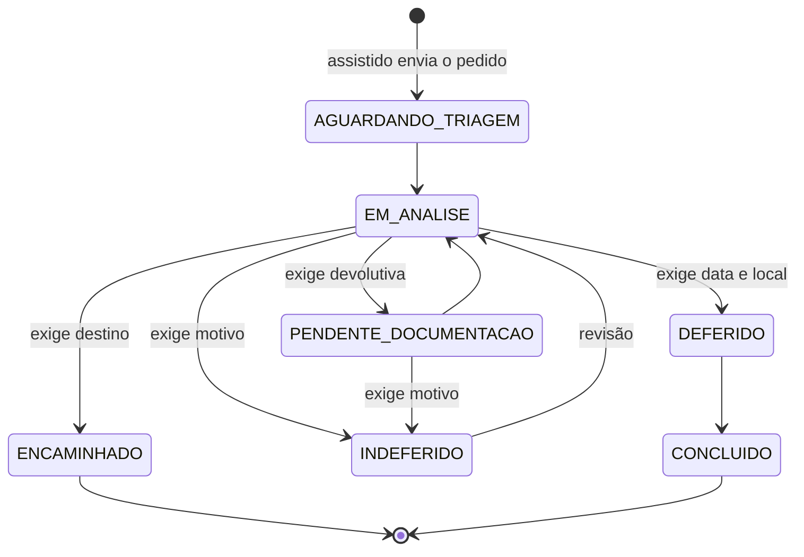

Qualquer transição fora desse mapa é recusada pela API. Cada mudança grava o histórico e dispara um e-mail ao assistido.

## Regras de negócio

- **Critério de renda.** Renda individual de até 3 salários mínimos gera hipossuficiência presumida; acima disso, o pedido é marcado como "requer análise". O salário mínimo e o número de salários são configuráveis (`dpe.salario-minimo` e `dpe.limite-salarios`). Não há recusa automática: quem decide é a equipe, que pode considerar despesas, dependentes e vulnerabilidades.
- **Prioridade.** O pedido é de prioridade alta quando o assistido tem 60 anos ou mais ou declarou alguma situação de vulnerabilidade, como deficiência ou violência doméstica. No quadro, esses pedidos aparecem com faixa verde à esquerda.
- **Documentos.** O assistido marca quais documentos já tem e pode enviar o pedido sem todos eles. A equipe vê quantos faltam no card e pode mover o pedido para "Pendente de documentação" com uma devolutiva explicando o que falta.
- **Indeferimento e revisão.** Indeferir exige um motivo, que o assistido vê no detalhe do pedido. Se quiser recorrer, ele escreve na conversa do pedido, e a equipe pode devolvê-lo para "Em análise".

## Decisões técnicas

- **React em vez de Angular.** A vaga cita React como diferencial; o front segue a mesma organização por funcionalidade que um projeto Angular teria, o que facilita uma versão futura nele.
- **Edição simultânea.** A solicitação tem `@Version`. Se duas pessoas movem o mesmo card, a segunda recebe 409 e o quadro avisa: "Este pedido foi alterado por outra pessoa. Recarregue o quadro."
- **E-mail depois do commit.** O envio roda em `@TransactionalEventListener(AFTER_COMMIT)` e `@Async`, então uma falha no servidor de e-mail não desfaz a mudança de status. Cada envio é registrado em `notificacao_email` com status e erro, e a equipe consulta esse log na tela de notificações.
- **Erros padronizados.** A API responde erros em ProblemDetail (RFC 9457) com um `requestId`. O mesmo código aparece na tela para o usuário e em todas as linhas de log da requisição, o que liga a reclamação ao log em segundos.
- **Liquibase com seed por context.** O schema sobe em todos os ambientes; os dados fictícios só entram com o context `dev`. O Hibernate apenas valida o schema (`ddl-auto=validate`).
- **LGPD.** O CPF aparece mascarado no quadro; o e-mail ao assistido traz só protocolo e situação, sem relato nem devolutiva; os logs registram ids e protocolos, nunca CPF, e-mail ou relato.
- **Sem Spring Cloud nem Elasticsearch.** É uma aplicação única com um banco; Spring Cloud resolve problemas de muitos serviços que este escopo não tem, e a busca do quadro (nome, CPF e protocolo) é atendida pelo próprio PostgreSQL no volume esperado.

## Próximos passos

- Upload de documentos no pedido, com armazenamento em objeto e verificação de tipo e tamanho.
- Refresh token, para sessões longas sem token de acesso de 8 horas.
- Elasticsearch para busca textual no relato dos pedidos.
- Versão do front-end em Angular.

## Como rodar os testes

Back-end (testes unitários e de integração, com PostgreSQL via Testcontainers; precisa de Docker):

```bash
cd backend
./mvnw verify
```

Front-end:

```bash
cd frontend
npm ci
npm test
```

O CI no GitHub Actions roda os dois a cada push na `main` e em todo pull request.

## Autora

Yandra de Morais — [github.com/yandramorais](https://github.com/yandramorais)
